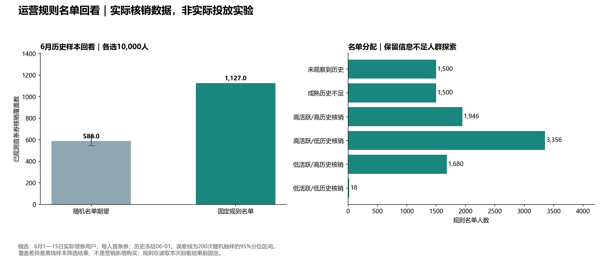
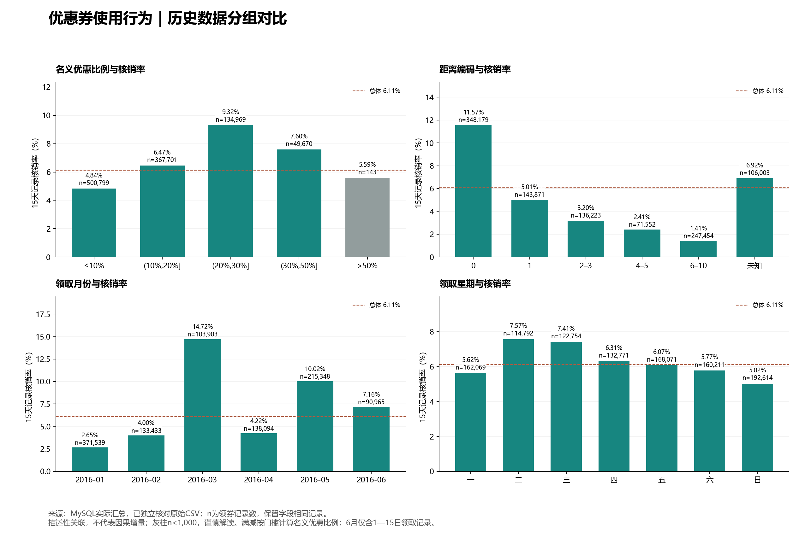

# 优惠券运营分析与用户分层策略

**策略运营 / 增长运营个人项目 · MySQL / Python · 公开历史数据**

优惠券资源有限时，怎样划分用户、分配重点与探索名额，并验证策略是否值得投入？
本项目从业务指标、人群分层出发，完成固定名额下的历史名单回看、成本敏感性分析和A/B测试方案。

## 主要结果

| 环节 | 结果 |
|---|---|
| 数据分析 | 175.49万条历史行为；105.33万条可评价15天领券记录，记录核销率6.11% |
| 用户分层 | 构建39.27万用户历史画像，将5月14.84万实际领券用户划分为六类 |
| 信息缺口 | 无历史及成熟历史不足用户占89.67%，设计70%历史充分、30%探索名额 |
| 离线回看 | 在6月76,257位实际领券用户中选10,000人，覆盖1,127次已观测首券核销；随机名单理论期望约588次 |
| 效果验证 | 270组明确标注假设的成本情景，以及尚未上线的用户级分层A/B方案 |

**1,127与588是历史核销的筛选覆盖比较，不能解释为新增订单或实际投放提升。**
相同名单人数也不等于相同总补贴成本。70%/30%是设计参数，未经实验证明为最优。



## 阅读顺序

1. [完整业务报告](reports/运营版_最终报告.md)：问题、指标、人群、名单规则与业务建议。
2. [A/B测试方案](reports/A_B测试方案.md)：上线后的随机分组、净收益指标和预算约束。
3. [结果口径与证据](docs/结果口径与证据.md)：事实、概率期望、假设情景的对应关系。
4. [数据来源](docs/data_sources.md)：2016年O2O赛事历史数据、下载来源和文件指纹。
5. [自包含HTML报告](reports/运营版_最终报告.html)：下载后用浏览器打开。



## 分析方法

- **指标口径**：区分领券记录核销率与用户核销率，只评价已具备完整15天观察窗口的记录。
- **时间边界**：按历史时点冻结画像；历史成熟核销率只使用当时已经完整观察的领券记录。
- **六类分层**：单列无历史、成熟历史不足人群；历史充分者按活跃度与历史核销响应划分四类。
- **名单策略**：70%历史充分名额、15%历史不足名额、15%无历史名额；组内按历史特征排序。
- **回看方法**：6月1—15日实际领券用户，每人首条券；随机基准使用精确期望和200次随机抽样。
- **标签隔离**：改写本次核销标签不改变规则名单，避免用结果反向筛选。

## 复现

无需原始数据即可核对公开汇总结果：

```bash
python scripts/check_public_results.py
```

完整重跑需要自行获取原始数据及重建SQL导出。原始数据、逐用户记录、数据库凭据与简历均不包含在仓库中。
详见[复现说明](docs/REPRODUCE.md)。主线不依赖模型训练；文件中的`model_samples_v1.csv`是早期命名的特征/标签表，规则回看不读取模型或预测概率。

```text
sql/               MySQL清洗、指标、历史画像与样本导出
src/               独立核验、分群、规则回看与报告生成
docs/              字段字典、规则、数据来源与复现说明
reports/           业务报告、图表、聚合结果与验证记录
scripts/           无需原始数据的公开结果核对
```

## 结论边界

公开O2O数据发生于2016年，不是当前平台的实际任职或上线业务。
历史回看的候选池是事后可见的实际领券用户，不能当作触达前已知的用户全集；6月此前做过描述性分析，因此不称为完全盲态验证。
缺少随机发券对照、毛利、实际补贴和触达成本，无法识别真实增量ROI；所有费用测算均为假设。
独立Hillstrom邮件实验仅作选读附录，不与优惠券用户拼接，也不把邮件实验效果移植到优惠券业务。
本项目代码与文档使用AI辅助编写，并通过本地计算、SQL结果核验和数据口径检查。
